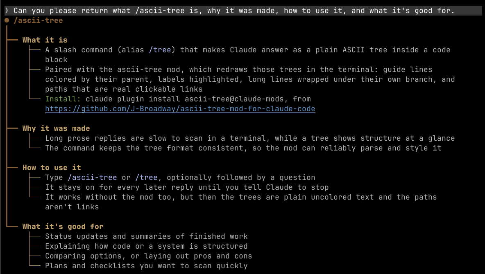
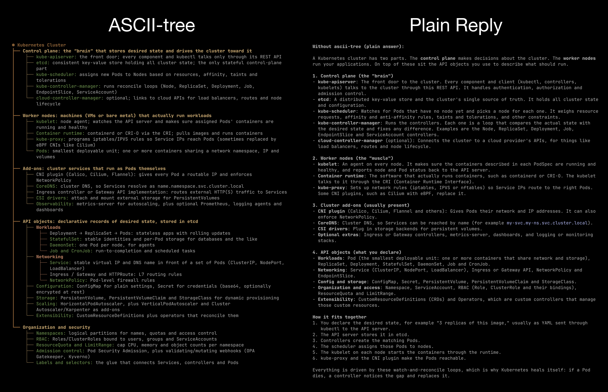
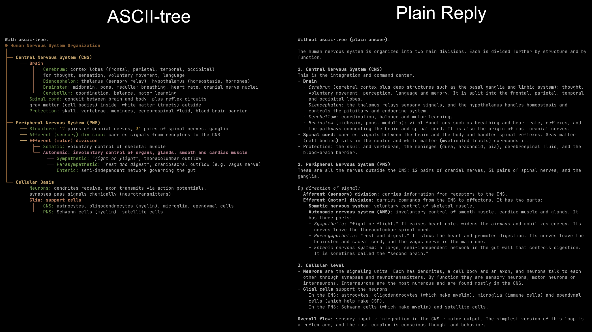

<div align="center">

# ASCII Tree Mod for Claude Code

### Ask a tree with ASCII Tree!

**Turn Claude's long replies into structured trees you can scan at a glance.**

[](LICENSE)
[](https://claude.com/claude-code)
[](ascii-tree/.claude-plugin/plugin.json)



</div>

## Before and after

Each question was asked in two fresh sessions, one with `/ascii-tree` and one without.

**"What's inside a Kubernetes cluster?"**



The plain reply squeezes each group of API objects into a single comma-separated bullet. The tree gives each group its own branch, and each item has its name highlighted.

**"How is the human nervous system organized?"**



Both replies nest four levels deep. The tree is about half the length, and you can trace each node back to its parent by following the guide lines.

## Features

<div align="center">

</div>

- **Lineage coloring.** Each guide line takes the color of the parent it hangs from: tan, clay, rosewood, then stone as the tree gets deeper.
- **Highlighting.** Paths, `/commands`, `--flags`, numbers, versions, dates, quotes and `key:` leaves each get their own style.
- **Clickable paths.** Absolute, `~/` and existing relative paths become `file://` links. Only paths that link are underlined.
- **Wrapping.** Long lines wrap under their own branch, and the guide lines continue unbroken.
- **Light themes.** A darker palette is used on light themes. Every color in it reaches WCAG AA contrast (4.5:1).

<div align="center">

</div>

## Install

```sh
claude plugin marketplace add J-Broadway/ascii-tree-mod-for-claude-code
claude plugin install ascii-tree@claude-mods
```

## Usage

Run `/ascii-tree` (or `/tree`), with or without a question. Claude keeps answering as a tree until you tell it to stop.

## Customize

Your settings live in `~/.claude/ascii-tree/`, outside the plugin, so updating the mod never overwrites them. Both files are optional, and edits apply to the next tree drawn without a restart.

- `config.json` sets colors per theme and adds, restyles or turns off highlight rules (for example, paths in purple, `prod` in red, no hex swatches).
- `preferences.md` is free-form prose added to the `/tree` and `/ascii-tree` prompt, such as "keep it to three levels".

### Highlight markers

A node that starts with a marker gets its opening statement (up to the first colon or full stop) highlighted, across every row it wraps onto. The built-in `⚠` marker puts a subtle amber background behind critical information.

You can add your own markers. Give a rule a `when` and Claude is told when to use it, so one entry in `config.json` sets both how a marker looks and when Claude writes it. A rule can also set a separate style for the light and dark themes:

```json
{
  "highlights": {
    "decision": {
      "match": "^◆",
      "scope": "lead",
      "when": "a decision the user must make",
      "style": { "backgroundColor": "#33283F" },
      "light": { "backgroundColor": "#EDE3F7" }
    }
  }
}
```

Every rule name, palette role and style key is listed in [`ascii-tree/CONFIG.md`](ascii-tree/CONFIG.md); ask Claude to read it before it edits your config.

## Develop

```sh
claude plugin validate ascii-tree
claude plugin test ascii-tree
```

## License

[MIT](LICENSE)
