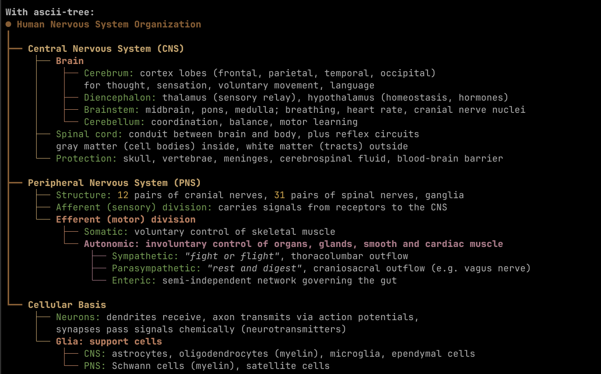
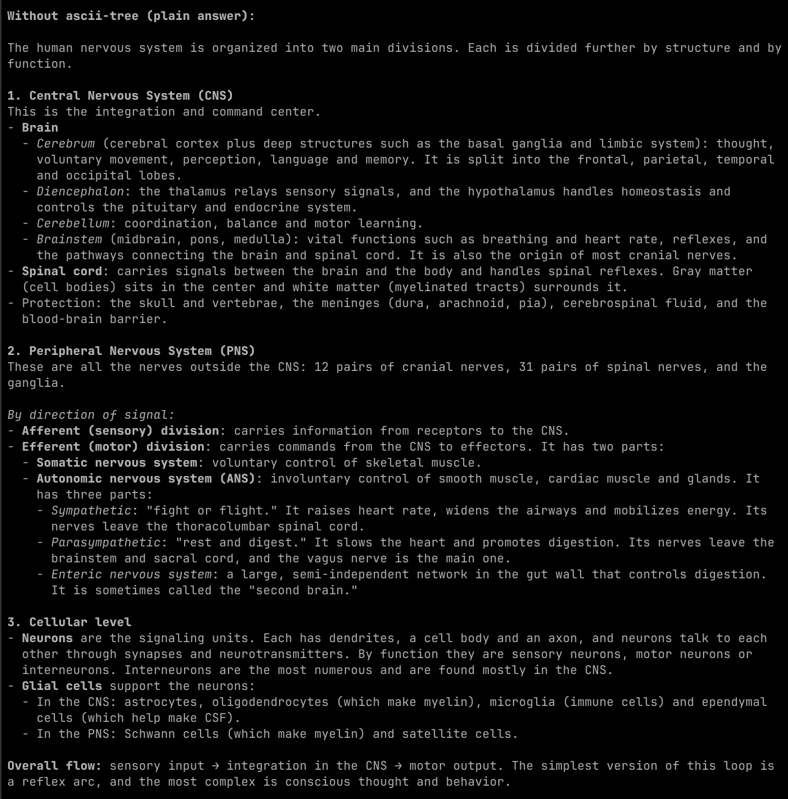
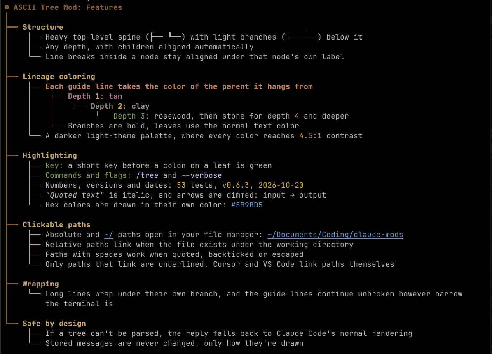
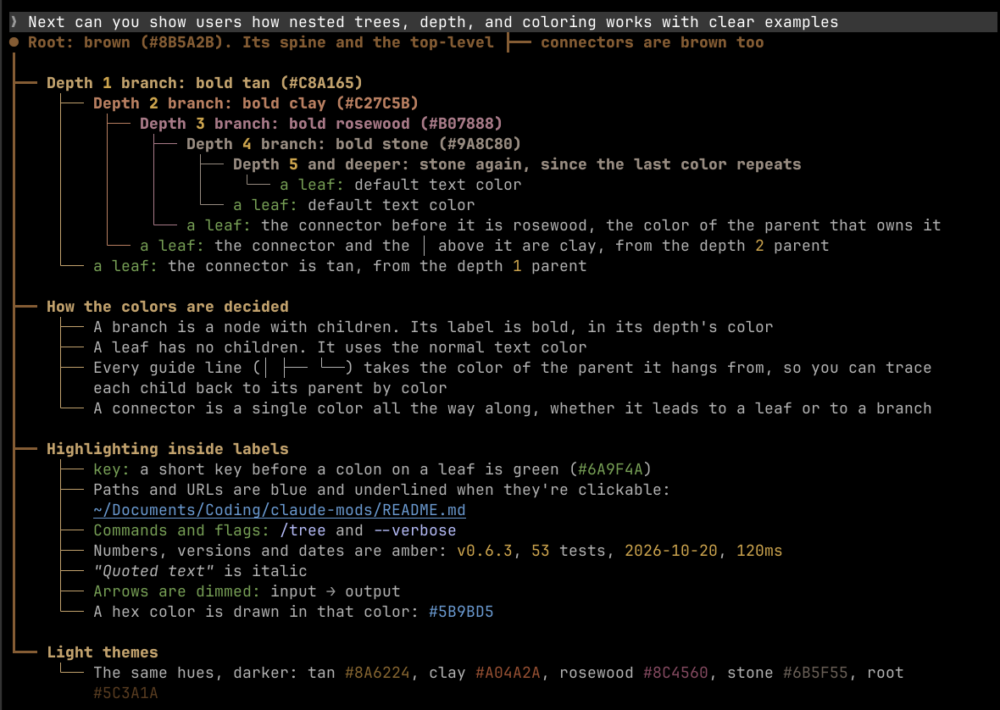

<div align="center">

# ASCII Tree Mod for Claude Code

**Turn Claude's long replies into structured trees you can scan at a glance.**

[](LICENSE)
[](https://claude.com/claude-code)
[](ascii-tree/.claude-plugin/plugin.json)



</div>

## Before and after

The same question, *"How is the human nervous system organized?"*, asked in two fresh sessions.

<table>
  <tr>
    <th width="50%">Plain reply</th>
    <th width="50%">With <code>/ascii-tree</code></th>
  </tr>
  <tr>
    <td></td>
    <td></td>
  </tr>
</table>

Both replies nest four levels deep. The tree is about half the length, and you can trace each node back to its parent by following the guide lines.

## Features

<div align="center">

</div>

- **Lineage coloring.** Each guide line takes the color of the parent it hangs from: tan, clay, rosewood, then stone as the tree gets deeper.
- **Highlighting.** Paths, `/commands`, `--flags`, numbers, versions, dates, quotes and `key:` leaves each get their own style.
- **Clickable paths.** Absolute, `~/` and existing relative paths become `file://` links. Only paths that link are underlined.
- **Wrapping.** Long lines wrap under their own branch, and the guide lines continue unbroken.
- **Light themes.** A darker palette is used on light themes. Every color in it reaches WCAG AA contrast (4.5:1).

<div align="center">

</div>

## Install

```sh
claude plugin marketplace add J-Broadway/ascii-tree-mod-for-claude-code
claude plugin install ascii-tree@claude-mods
```

## Usage

Run `/ascii-tree` (or `/tree`), with or without a question. Claude keeps answering as a tree until you tell it to stop.

## Develop

```sh
claude plugin validate ascii-tree
claude plugin test ascii-tree
```

## License

[MIT](LICENSE)
